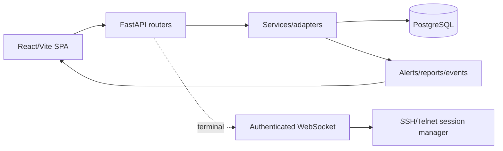
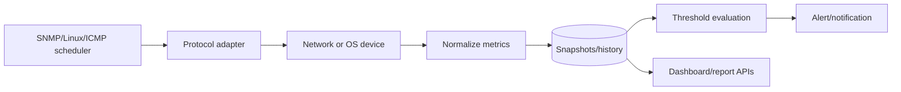
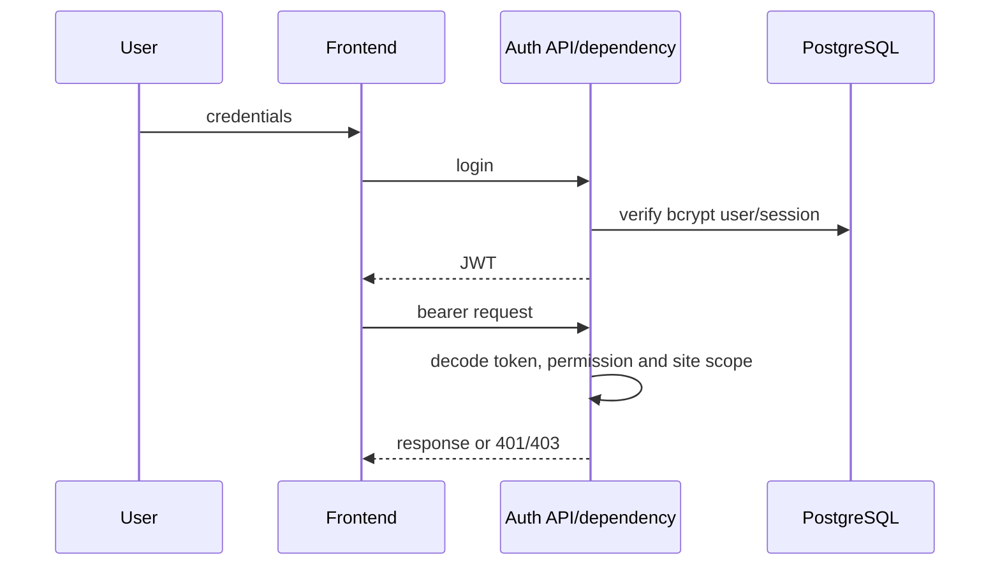

# End-to-End Data Flows

The diagrams describe source-supported paths and use **UNVERIFIED** where no runtime execution was permitted.

## Overall

## Monitoring

## Authentication/RBAC

Device onboarding/discovery, WinRM monitoring, alert recovery, report generation, and collector ingestion are represented by corresponding service/router/model code, but each remains runtime **UNVERIFIED**. A separate remote-collector architecture is not supported by verified repository evidence.

