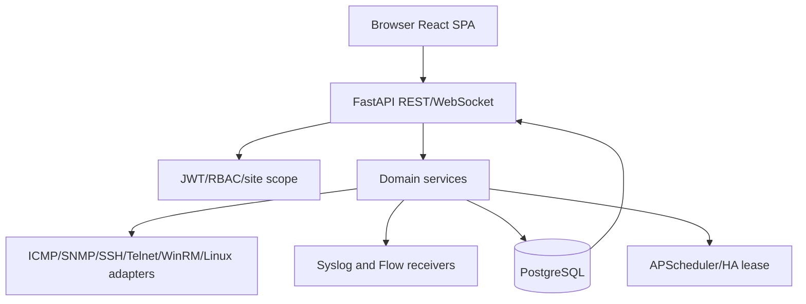

# AgniGate NMS — High-Level Technical Design

**Version:** 1.0 static audit baseline  
**Date:** 2026-11-04  
**Repository:** `/home/agnigate/Desktop/NMS`  
**Verification:** Read-only source audit; runtime behavior and live schema are unverified.

## 1. Executive summary

AgniGate NMS is a React/Vite frontend backed by a FastAPI modular monolith. It persists inventory, monitoring observations, alerts, reports, ITSM and knowledge data in PostgreSQL through SQLAlchemy. Scheduler-owned protocol adapters collect ICMP, SNMP, Windows and Linux data; optional event receivers ingest syslog and sFlow/IPFIX. JWT/RBAC/site-scope controls protect API and UI functions. The implementation is broad, but reproducible deployment, live verification, retention, and some multi-site/collector claims require further evidence.

## 2. Scope and objectives

The system scope evidenced in source includes network discovery and inventory, availability/performance monitoring, OS monitoring, topology, alerting/notifications, reporting, remote access, administration, security audit, CMDB/APM/RCA and ITSM workflows. Business objectives inferred from these modules are centralized visibility, proactive alerting, operational diagnostics and controlled change/incident workflows.

## 3. Technology stack

Python/FastAPI/Uvicorn, SQLAlchemy/PostgreSQL/psycopg, Pydantic settings/schemas, APScheduler, Redis support, pysnmp, Paramiko, pywinrm/pypsrp, ReportLab/openpyxl, React 19, TypeScript, Vite 8, React Router, TanStack Query, Recharts, xterm and Tailwind CSS v4.

## 4. High-level architecture

## 5. Component and data architecture

API routers map to services, protocol adapters and SQLAlchemy models. The database groups are identity/tenancy, inventory, monitoring, OS snapshots/history, flow/syslog, reports, ITSM, CMDB/APM/RCA and knowledge. Device observations are normalized, persisted, threshold-evaluated and surfaced through dashboard/report APIs. See `04_BACKEND_ARCHITECTURE.md`, `06_DATABASE_ARCHITECTURE.md` and `11_DATA_FLOW_DIAGRAMS.md`.

## 6. Monitoring/protocol architecture

SNMP has dedicated clients, security, OID/vendor identity, collectors, normalization and scheduler components. ICMP has a monitoring engine and availability persistence. Windows uses WinRM/CIM and CA trust services; Linux has service/metrics/detection/scheduler modules. SSH/Telnet provide discovery or remote terminal access. Syslog and flow are optional receivers. Native Windows sensor support must not be interpreted as universal hardware coverage; unsupported/unavailable/permission states are part of the implementation evidence.

## 7. Alerts, reports and operations

Thresholds and event engines feed alerts and notification intents; SMTP/report-email services are configured through settings. Report CSV/XLSX/PDF generation and schedules are present. Incident/problem/change, RCA, CMDB, compliance, backup, QoS, BGP, APM and knowledge modules extend operational workflows.

## 8. Security and tenancy

JWT HS256, bcrypt, Fernet credential encryption, role authority, permissions, user-site assignments, SSH host keys, Windows CA trust and audit records are implemented in source. Production secret checks exist. Transport deployment, comprehensive endpoint site isolation and live secret configuration remain verification items.

## 9. Deployment and reliability

The source supports Uvicorn/local startup, PostgreSQL, optional Redis, in-process schedulers and optional listeners. Startup performs schema/setup/reconciliation and restores work. No reproducible container/reverse-proxy/service-unit package was verified. Process coupling and schema startup behavior are material reliability risks.

## 10. Implementation status

Core monitoring, discovery, SNMP, Windows/Linux, alerting, reporting, remote access, administration, topology, syslog/flow, ITSM, CMDB/APM/RCA and knowledge are **IMPLEMENTED — UNVERIFIED**. Remote collectors and broad service/application monitoring are **PARTIAL**. No modules were classified as production-verified because runtime execution was prohibited.

## 11. Scalability, risks and recommendations

Priorities are: establish CI/runtime evidence; unify migration management; define deployment artifacts and TLS; enforce consistent site authorization; implement retention/partitioning and capacity monitoring; isolate scheduler/receiver/terminal failure domains; reduce legacy/duplicate route surface; and formalize collector architecture if distributed monitoring is required.

## 12. Appendices

For the detailed folder tree, module matrix, API-family inventory, security findings, database groups, protocol evidence, data-flow diagrams and test boundary, see the companion files in `technical_audit/`.

